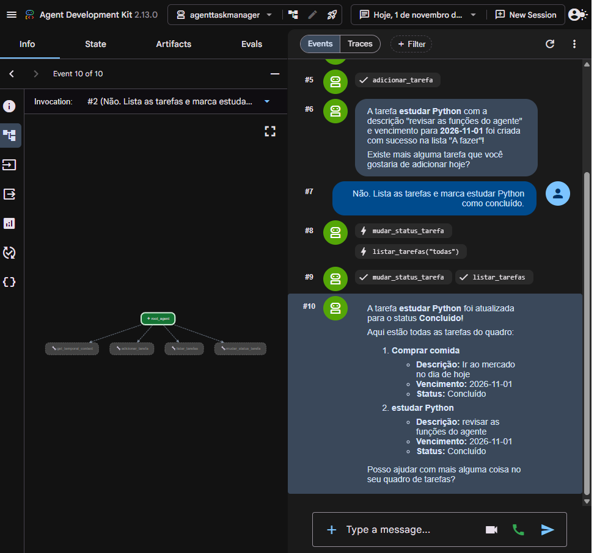
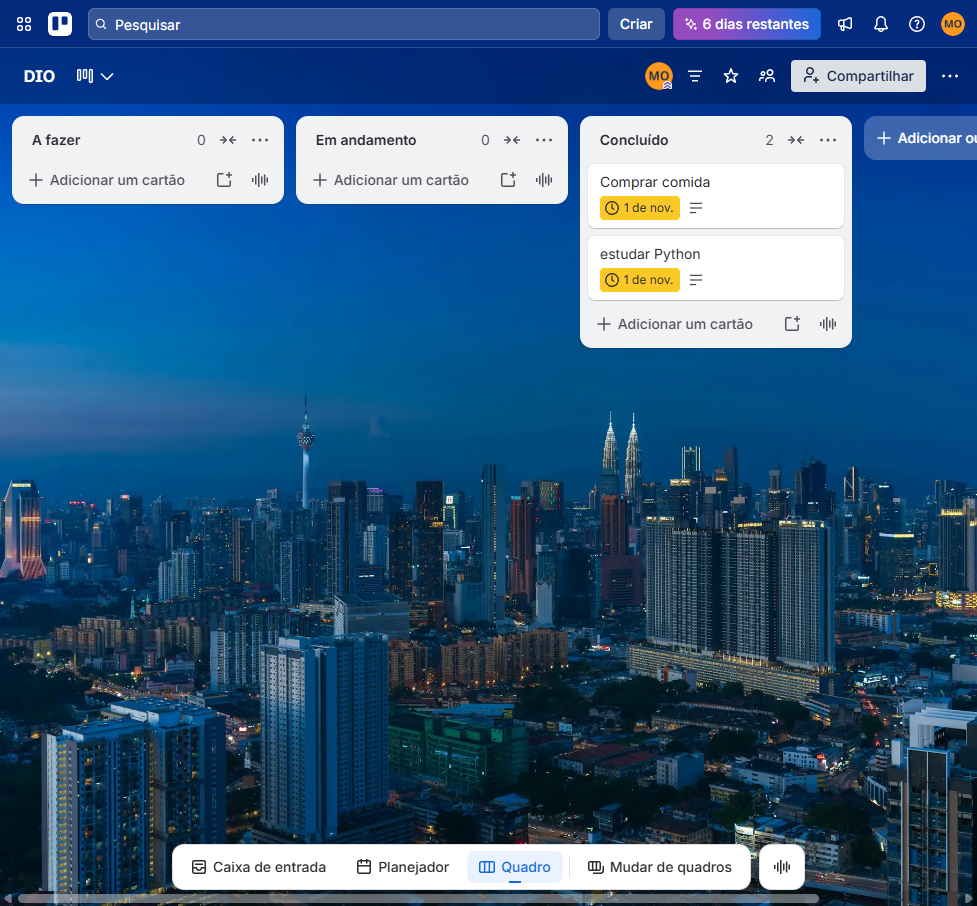

# Agente de tarefas no Trello

Agente em Python que organiza as tarefas do dia num quadro do Trello, a partir de uma conversa. Ele usa o Agent Development Kit (ADK) do Google e o modelo Gemini. Cada ação é uma função Python registrada como ferramenta.

O quadro usado na configuração de exemplo se chama **DIO** e tem as listas **A fazer**, **Em andamento** e **Concluído**.

## Ferramentas

| Ferramenta | O que faz |
| --- | --- |
| `get_temporal_context` | Informa a data e a hora atuais no fuso de Brasília (UTC-3). A conversa começa perguntando as tarefas do dia já com essa data. |
| `adicionar_tarefa` | Cria um card em **A fazer**, com nome, descrição e vencimento. |
| `listar_tarefas` | Lista todos os cards ou só os de um status. |
| `mudar_status_tarefa` | Move o card entre **A fazer**, **Em andamento** e **Concluído**. |

## Melhoria

O código de partida gravava o vencimento só com o dia. O Trello interpreta isso como meia-noite em UTC, e no Brasil o card aparecia no dia anterior. A ferramenta `adicionar_tarefa` agora envia a data ao meio-dia com o fuso `-03:00`, então o card fica no dia certo.

A outra correção é o status. `concluído`, `concluida`, `done` e as outras formas deixam de cair em "status inválido". A comparação ignora acento e maiúsculas, tanto ao listar quanto ao mover. A conexão com o Trello ficou numa função só, e cada ferramenta devolve o erro em texto em vez de quebrar a conversa.

A instrução do agente descreve só o que as ferramentas fazem de verdade: criar, listar e mover. Ela não promete apagar tarefa.

## Como configurar

É preciso Python 3.10 ou superior, uma conta no Trello e uma chave gratuita do Gemini no [Google AI Studio](https://aistudio.google.com/apikey).

1. No Trello, crie um quadro com as listas **A fazer**, **Em andamento** e **Concluído**.
2. Em [trello.com/power-ups/admin](https://trello.com/power-ups/admin), crie um aplicativo e anote a chave e o segredo.
3. Autorize um token em `https://trello.com/1/authorize?expiration=never&scope=read,write&response_type=token&key=SUA_CHAVE` e clique em Permitir.
4. Copie `agenttaskmanager/.env.exemplo` para `agenttaskmanager/.env` e preencha a chave do Gemini, a chave, o segredo e o token do Trello. Se o quadro não se chamar DIO, mude `TRELLO_BOARD_NAME`.

```bash
python -m venv .venv
.venv\Scripts\activate
pip install -r requirements.txt
adk web
```

No Linux ou no macOS, o ativador é `source .venv/bin/activate`. O `adk web` abre a conversa no navegador. Escolha o agente `agenttaskmanager`.

## Credenciais

Chave, segredo e token ficam somente no `agenttaskmanager/.env`. Esse arquivo está no `.gitignore` e não entra no repositório. O `.env.exemplo` traz só texto de exemplo. Troque o token no Trello se ele tiver sido compartilhado.

## Como testar

1. Suba o `adk web` e abra o quadro ao lado.
2. Diga as tarefas do dia e confira um card novo em **A fazer**, com o vencimento no dia certo.
3. Peça a lista de tarefas.
4. Diga que uma tarefa foi concluída, usando a palavra com acento, e confira o card em **Concluído**.

O teste feito em 1 de novembro de 2026 pediu a tarefa **estudar Python** e, em seguida, a lista com o status **concluído**. O vencimento ficou em 1 de novembro, o dia informado, e os dois cards apareceram na lista **Concluído**.




